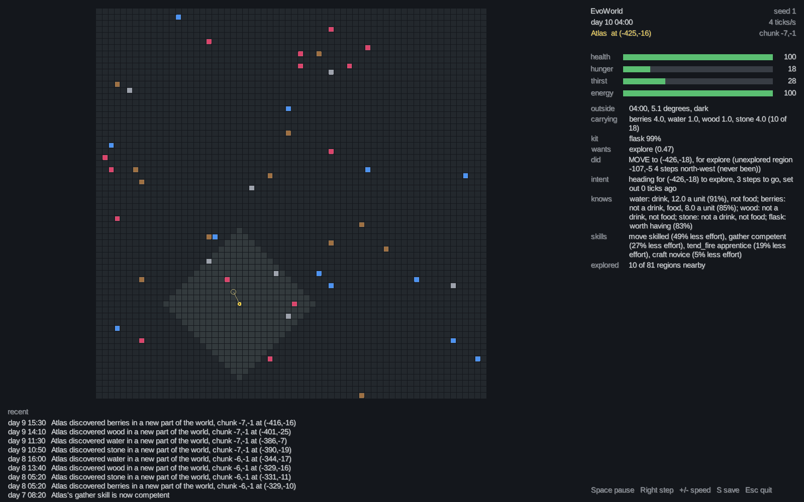

# EvoWorld

An autonomous life simulation, with a window to watch it in. You are not the player. You
start a world and watch an agent, Atlas, live in it: he explores, finds food and water, works out what
things are worth by trying them, remembers where he found them, gets better at what he
does, and carries on for weeks of simulated time without anyone touching anything.

```
[day 1 00:10] Atlas discovered first ever sight of water at (3,8)
[day 1 22:20] Atlas learned water hydration: 12.0 thirst per unit (0.25 sure after 1)
[day 2 01:50] Atlas's move skill is now skilled
[day 2 04:20] Atlas learned wood nourishment: 0.0 hunger per unit (0.25 sure after 1)
[day 2 05:30] Atlas learned berries nourishment: 8.0 hunger per unit (0.25 sure after 1)

-- day 7 00:00 -- Atlas ------------------------------------------------
   status     alive, age 6d 0h, health 100.0
   location   (-264,-30)
   needs      hunger 28.8, thirst 55.7, energy 90.8
   carrying   berries 1.0, wood 5.0
   wants      recover energy (0.58)
   doing      sleeping, 50m left
   intent     heading for (-266,-28) to satisfy thirst, 4 steps to go, set out 45 ticks ago
   remembers  water at (-266,-28); found berries at (-259,-32); berries at (-259,-32);
              found wood at (-257,-29); found stone at (-257,-31)
   knows      berries: not a drink, food, 8.0 a unit (75%);
              water: drink, 12.0 a unit (85%), not food; stone: not a drink;
              wood: not a drink, not food
   skills     move skilled (49% less effort), gather apprentice (14% less effort)
   explored   22 of 81 regions nearby
```

Nothing in that output was scripted. Atlas is born knowing nothing about berries. The
lines above are what he worked out on his own.

**Contents:** [Vision](#vision) · [MVP features](#mvp-features) ·
[Architecture](#architecture) · [The simulation loop](#the-simulation-loop) ·
[AI architecture](#ai-architecture) · [Persistence](#persistence) ·
[Running it](#running-it) · [Testing](#testing) ·
[Known limitations](#known-limitations) · [Future directions](#future-directions)

## Vision

EvoWorld is meant to grow into a living procedural world: agents, animals, resources,
weather, societies, economies, possibly several worlds. The long-term interest is in
behaviour that **emerges**: agents that perceive, want, decide, act, remember and learn,
rather than NPCs following a script.

The design principle that follows from that runs through the whole codebase: **nothing
says "if hungry, go to berries".** There is a hunger that grows, a want that grows with
it, a set of things the agent could do, and a score for each. Behaviour is whatever
wins. That is what lets new behaviour come from new options rather than new branches,
and what leaves room for learning.

The MVP is the smallest honest version of that: one world, one agent, four resources,
and the full pipeline from perception to learning, running unattended and reproducibly.

## MVP features

| Area | What exists |
| --- | --- |
| World | an endless seeded world in 64×64 chunks, built as it is walked into and stable ever after; country that varies from berry field to bare slope; berries, water, wood and stone that regrow at their own rates (stone never does); a day and a night with a spring temperature that peaks mid-afternoon. A walled world of any size is still available |
| Time | discrete ticks of configurable simulated length (default 10 minutes); days and hours in all output |
| Body | hunger, thirst, energy and health at realistic hourly rates; energy spent awake and restored asleep; unmet needs that do damage; healing when looked after, fastest asleep |
| Actions | move, gather, eat, drink, rest, sleep, craft, tend a fire, discard; explicit preconditions, structured outcomes, multi-tick work |
| Perception | a field of view of twelve steps by day and four in the dark; nothing beyond it is known except by memory |
| Goals | seven wants (thirst, hunger, energy, health, curiosity, provisioning, warmth) scored from the agent's state, never from a rule |
| Decisions | propose, evaluate, select: six-factor utility, no if/else behaviour anywhere |
| Memory | six kinds of memory with decaying confidence, bounded, recalled by relevance |
| Knowledge | general beliefs learned from outcomes, distinct from memory; the agent starts ignorant |
| Exploration | a coverage map, frontier-seeking, discoveries, curiosity-driven experiments |
| Skills | practice at walking and gathering makes them cheaper |
| Events | a curated stream of the moments worth mentioning |
| Persistence | save, load and continue, exactly, as JSON |
| Console | events, periodic status blocks, four log levels, configurable speed |

Across twenty seeds, every agent survives 2,000 ticks (83 simulated days) with no
intervention, and none walks back and forth between two targets. The MVP lost seed 10
that way; [ADR 29](docs/adr/0029-an-agent-finishes-what-it-sets-out-to-do.md) tells how
that was fixed.

## Architecture

```
simulation-core          the simulation: world, agents, minds, the tick loop. No I/O, no rendering.
simulation-persistence   JSON save files, via Jackson. Depends on the core.
simulation-runner        the headless command-line application and the survey. Depends on both.
simulation-viewer        a LibGDX window that plays a run live. Depends on all three.
```

The core depends on SLF4J and nothing else. Jackson appears only in the persistence
module, Logback only in the runner, and LibGDX only in the viewer. The viewer is one more
observer: it reads the same immutable values the console prints, and the core has no
rendering code.

Four properties the design protects, each enforced by tests rather than by convention:

- **The core never depends on presentation.** Observers receive only immutable values:
  `WorldState` snapshots, events, `AgentStatus` reports. Nothing an observer holds leads
  back to anything that can change, so watching a run cannot alter it.
- **The mind cannot see the world.** Decisions are made on a `Perception`: a filtered,
  immutable observation with no route back to the live world. An agent cannot act on a
  berry bush it has no way of knowing about.
- **Runs are reproducible.** One seeded random stream, owned by the simulation, drives
  everything stochastic. Collections that affect behaviour iterate in insertion order,
  and ties break deterministically. The same seed produces the same run, byte for byte,
  on any JVM. World generation draws from its own named stream, so changing how the agent
  thinks never moves the berries.
- **Everything is explainable.** Every decision carries its reasons, every memory its
  timestamp and confidence, every belief the count behind it.

The reasoning behind each significant decision is recorded in [docs/adr](docs/adr), 33
records in all. They include the ones where a first attempt was wrong.

## The simulation loop

Every tick runs fifteen phases in a fixed order. `Simulation.tick()` is written to read
as this list:

| # | Phase | Where |
| --- | --- | --- |
| 1 | advance world time | `SimulationClock` |
| 2 | update the environment: resources regrow | `World` |
| 3 | update needs for the tick just lived | `Agent.live` |
| 4 | perceive the environment | `PerceptionSystem` |
| 5 | retrieve relevant memories | recalled into the `Perception` |
| 6 | update goals | `MotivationSystem` |
| 7 | generate candidate actions | `ActionProposer`s |
| 8 | evaluate them | `ActionEvaluator` |
| 9 | select one | `ActionSelector` |
| 10 | execute it | `Action.execute` |
| 11 | process the consequences | `ActionOutcome` |
| 12 | create memories | `MemoryRecorder` |
| 13 | update knowledge | `KnowledgeLearner` |
| 14 | update skills | `Skills` |
| 15 | report what was worth reporting | `SimulationEvent` |

The world and the body change **before** the mind looks at them, so an agent always
decides on the world as it now is. An agent whose needs killed it overnight does not get
to act in the morning. Actions that take several ticks (gathering takes two) occupy the
agent, whose body keeps paying for every tick. The action's precondition is checked
again when it completes, in case the world moved on.

Time is **simulated** time. The core contains no wall-clock time at all; how fast a run
goes is set in the runner and cannot affect what happens.

## AI architecture

No machine learning, no language model. Every mechanism is explicit arithmetic that can
be checked by hand.

### Perception

The only route from world to mind. A `Perception` holds three distinct kinds of
knowledge:

- **self:** the agent's own body and inventory, always known in full.
- **sensed:** resources and agents within twelve **steps** (walking distance, so "four
  steps north" is directly comparable to what walking there will cost).
- **known:** remembered places the agent can no longer see, with faded confidence; where
  there was a *lot* of something, faded the same way; everything it has worked out; how
  familiar the country around it is.

### Goals

Five goals each score themselves from the agent's state. A goal says **what**, never
**how**. Nothing in the goal layer knows an action exists.

| Goal | Priority |
| --- | --- |
| satisfy thirst | `0.4 × thirst/100 + 0.6 × (thirst / 100)²` |
| satisfy hunger | `0.4 × min(1, hunger/50) + 0.6 × (hunger / 100)²` |
| recover energy | `(1 − energy / 100)²` |
| recover health | `(1 − health / 100)²` |
| explore | `0.6 × energy × unexplored fraction × (1 − most pressing need²)` |
| stay provisioned | `0.3 × (1 − supplies carried / a day's worth) × (1 − most pressing need²)` |
| keep warm | `(rest the cold would cost) × (1 − fire in hand) × (1 − most pressing need²)` |

Hunger and thirst are an **appetite** and an **urgency** at once. The appetite comes
early and levels off: a few hours after a meal he is peckish and eats if food is at hand.
The urgency is nothing at first and everything at the end, so severe thirst drowns out
everything else. Below 5, a need is not felt at all: nobody walks to a spring for a
thirst they cannot notice.
Curiosity is what is left once survival has had its say, so a comfortable agent explores
and a dying one does not. Injury does *not* quiet curiosity. Exploring is how a newborn
finds food, and when injury was counted against curiosity, three wounded newborns in
twenty starved.

### Day, night and fire

The world has hours. `Sky` gives the light and the temperature from the time of day and
nothing else — no state, nothing saved, the same on every run of a seed — so weather and
seasons can later bend those two numbers without anything else changing.

- **The shape is the real one.** Light is full between six and seven with twilight either
  side. Warmth runs between the coldest hour, five in the morning at 5°C, and the warmest,
  three in the afternoon at 16°C: the ground goes on cooling after midnight and on warming
  after noon, which is why the small hours are the ones worth a fire for.
- **Cold does two things, because the body has two currencies.** Shivering is work, so it
  adds to what a tick costs; sleeping cold is poor recovery, so it scales what a tick gives
  back — through the same comfort a bed was always going to use. Darkness enters here too,
  and only helps: a body rests better in the dark.
- **Night is genuinely darker.** Sight falls from twelve steps to four. Nothing says "stop
  travelling at night"; there is simply less to find out there.
- **A fire is the first thing an agent puts into the world.** Three steps of warmth, twelve
  degrees at the centre, half a unit of wood an hour, burning on whether or not anyone is
  watching. It is wanted for what the night would otherwise cost, discounted by the fire
  already burning — judged by the fire that is warming him, not the tile he stands on.

Left alone, Atlas keeps a few sticks on him, lights a fire on most nights, sleeps beside
it and wakes rested. A spring night costs him about an hour of extra sleep when he has no
fire, which is the clearest measure of what a fire is for. It is not dangerous: twenty
seeds of twenty days across six scenarios all survive.

### Carrying, containers and making things

Water used to be something you could only drink where you found it, and the survey put
about two hours of every day into walking back to a spring. A flask changes that, and
nothing about the decision layer had to change to let it:

- **A container is not a place water goes; it is the reason water can be carried at all.**
  Water needs something to carry it in, so an agent with no flask has no room for water
  however empty its pack. With one, drinking from the pack is the exact mirror of eating
  from it, and the evaluator weighs a sip in hand against a walk to a spring on the usual
  terms.
- **One new want: stay provisioned.** Every other goal answers a need the body feels now,
  which is why none of them would ever fill a flask - water in a skin relieves no thirst
  while you are standing in a spring. This one says "I would rather have a day's water on
  me than not", and knows nothing of flasks or springs. It goes quiet when anything is
  actually the matter, exactly as curiosity does.
- **Recipes are known; what a thing is worth is not.** A flask is six wood; an axe is wood
  and stone. Whether any of it is worth the trouble is a belief that starts as a hunch and
  is settled by owning one - a drink out of the pack is evidence that a flask was a good
  idea, learned by the same machinery that learns what berries are worth.
- **Tools compound with skill.** A gather costs `energy × skill × tool` and yields
  `amount × tool`, and using a tool wears it out.

Left alone, Atlas picks up wood he walks past, makes a flask, fills it whenever he is at
water, drinks from it a day's walk away, and comes to believe - at about 90% confidence -
that flasks are worth having. Water travel falls by about 57% in the default world, and
free time rises from 47% to 51%.

### A body in real time

Every rate that changes a body or the world is stated **per simulated hour** and turned
into ticks once, so an hour is an hour at any tick length. So are walking speed (six tiles
an hour, a tile being ten minutes' walk) and the time a gather takes (20 minutes).

| | Per hour | What it means |
| --- | --- | --- |
| thirst | +2.0 | hurts after about two days without water; a gulp covers about six hours |
| hunger | +0.7 | hurts after about five and a half days without food; a portion covers about eleven hours |
| energy, awake | −5, or −1.5 sitting still | about fifteen hours from rested to sleepy |
| energy, asleep | +10 | about seven and a half hours from sleepy to rested |
| damage when starving, parched or spent | 0.6 / 4 / 2 | about a week, a day, two days to die |
| healing when well: active, resting, asleep | 0.25 / 1 / 2 | sleep is where a body mends |

**Sleep** is its own action: a long block, sized when he lies down to bring energy back to
full, never longer than ten hours, and cut short if hunger or thirst would start hurting
before he woke. He is only sleepy below 25 energy, so he stays up until the day is spent
and then sleeps once, rather than napping. A badly hurt agent (health 50 or less) lies
down to mend whatever its energy. Resting only slows the drain.

The body recovers through the **metabolism**, tick by tick, according to what the tick was
spent doing and how comfortably. Comfort is 1 on bare ground; it multiplies what comes
back, never what anything costs. That is the hook for equipment: a bed will be a sleep
with more comfort, and nothing else has to change for one to exist.

**Healing** is part of the same metabolism. A body that is looked after (hunger and thirst
at most 50, energy at least 25) mends, fastest asleep. Those conditions are far from
anything that does damage, so no tick both hurts and heals.

The result, over 20 seeds and 20 days each, from [docs/survey.md](docs/survey.md):

| | A day |
| --- | --- |
| sleep | 8.8 hours, about one night |
| meals | 2.6 |
| drinks | 5.1 |
| walking for water | about 3.6 hours: water cannot be carried yet |
| free for exploring | about 10 hours |

### Deciding: propose, evaluate, select

There is no decision tree. `DeliberativeDecisionMaker` runs three collaborators and has
no logic of its own:

- **Proposers** (one per kind of thing an agent might do) offer candidates, reading only
  the perception. Each candidate says which goal it serves. That is the only place in the
  system that knows drinking relieves thirst.
- **The evaluator** scores each candidate with a product of fractions:

  ```
  utility = want × benefit × confidence × timeliness × affordability × (1 − risk)
  ```

  Any factor at zero kills the candidate: no want, no point; no energy, no chance.
  *Confidence* is where knowledge and memory enter: how sure the agent is that the thing
  is there, times how sure it is that the thing is worth having. The first factor is
  full for something seen and faded for something remembered. The second is a hunch
  until the agent has tried the thing. The same rule applies either way, so a
  remembered bush never outscores the same bush in view. *Risk* projects the
  needs forward to when the benefit would land and charges the damage they would do by
  then.
- **The selector** takes the best score, ties to the earlier candidate.

Travelling needs no plan. Walking toward a spring is valued at what drinking there would
be worth, discounted by the walk. On arrival the walk becomes impossible and the drink
is proposed undiscounted.

**Intent** keeps a trip going. Choosing to head somewhere sets the agent out on an intent:
a goal, a place, and when it set off. The evaluator is wrapped in a
`CommitmentEvaluator` that scores any option carrying the trip on 1.3× higher, so a
near-tie does not turn the agent round. A rest or a meal on the way is a pause, not a
change of mind. The intent ends on arrival, or when the trip has taken three times as
long as it should. The bonus multiplies, so a trip whose goal is no longer wanted still
scores nothing.

`ActionEvaluator`, `ActionSelector` and `DecisionMaker` are interfaces. A learned scorer,
an exploration-sampling selector or a planner can replace any of them without touching
the proposers or the loop.

### Memory

Memory is **a question, not a log**. The decision layer can only ask `recall(query)` and
receive a ranked answer; it cannot iterate anything. The store is bounded at 48 memories
and forgets the least valuable (`confidence × importance`) first.

| Kind | Half-life | Why |
| --- | --- | --- |
| resource location | 4,000 ticks | a spring does not wander off |
| observed resource | 200 ticks | but it does empty, and refill |
| successful / failed action | 600 ticks | what worked here, for a while |
| danger | 1,500 ticks | you remember nearly dying |
| world event | 800 ticks | something changed |
| discovery | 2,000 ticks | finding something is worth keeping |

Relevance is `confidence(now) × importance × 1/(1 + distance/8)`. An agent ends up sure
where the water is and unsure whether there is any left, which is the state of knowledge
that makes going to look worthwhile. Routine successes, like a step taken, are not
remembered; they crowded discoveries out of the store before that rule existed.

### Knowledge

| | Memory | Knowledge |
| --- | --- | --- |
| Holds | one episode, at a place and time | one general claim |
| Example | "I found berries at (4,3)" | "berries are worth 8 hunger a unit" |
| Over time | confidence halves | confidence grows |

**The agent is born ignorant.** The decision layer never reads what a resource is actually
worth. That is physics, known only to the action when it runs. What the agent expects
comes from its own beliefs, each a running mean with confidence `n/(n+3)`. It learns from
four kinds of experience:

- **ate something and hunger fell:** relief divided by units eaten is what a unit is worth
- **drank something and thirst fell:** the same arithmetic
- **told permanently that a thing isn't food:** it is worth nothing, settled in one go
- **went somewhere for something and it wasn't there:** such places are less reliable

A meal that leaves the agent completely full only proves the food is worth *at least*
that much, so it is treated as a lower bound. It can confirm a belief or raise it, never
pull it down. Twenty days in, Atlas believes berries are worth 8.0 and water 12.0, the
true values, at 98% confidence.

### Exploration and experiment

A coverage map records how recently the agent stood in each 4×4 region, with familiarity
halving every 500 ticks. The frontier is simply the least familiar regions - least
familiar first and, among places equally unknown, the nearest. A swept map makes
curiosity fall; familiarity fades; curiosity returns and the agent goes round again.
Nothing schedules it.

Because the world has no end, all of this is measured over a **window** around the agent
rather than over the whole map: an agent that measured itself against an endless world
would be forever at nought, restless wherever it stood.

The map also keeps **what the country was like**: per region, the most of each kind it saw
there at once, faded by how long ago. That is the difference between "there was a bush
over there" and "that whole slope was berries" - one is a meal, the other is worth the
walk again tomorrow. Wood and stone are recorded too, ready for crafting to want them.
Somewhere he has never been offers nothing, however rich it is: this is memory, not second
sight.

A **discovery** is the first sighting of something, or of something in a chunk of the world
where he had not seen it before. No list of discoveries exists anywhere; they come from
comparing what is in view with what the agent has seen before.

When comfortable, an agent **experiments**: it tastes things it has never tried, and walks
to an untried kind of thing in sight to try it, for curiosity's sake rather than hunger's.
Curiosity that only worked underfoot let a newborn walk past springs for a day and a half
and then meet its first real thirst knowing nothing. The reward is what is left to learn. The risk is
a tick, a mouthful, and what its needs do meanwhile. Samples it has found useless are put
down when they are taking up room it needs.

## Persistence

A simulation can be saved between any two ticks and carried on from exactly that point.
**Exactly** means identical, not similar: the same decisions on the same ticks, the same
events, the same random draws. A 20-day run and a 10+10 run split across two separate
processes end with byte-identical save files.

What is saved: the configuration, simulated time, the random generator's full state,
every resource node, and for each agent its body, inventory, age, memories (in order,
because order decides what is forgotten next), beliefs, skills, coverage and what it
found where, any job it is part-way through, and which of its needs were already doing
damage.

What is not saved, deliberately: goals, which are recomputed from needs at every
decision; the standard decision maker, which is stateless; and observers.

Three design choices make exactness possible
([ADR 27](docs/adr/0027-saves-are-exact-and-the-format-is-not-the-domain.md)):

- **The random generator is written out.** `SimulationRandom` implements the generator
  specified for `java.util.Random` (and is tested against it draw for draw), so its whole
  state is one number that can be saved.
- **The save format is not the domain.** `core.save` holds flat records of numbers,
  strings and enums, translated by one class. Refactoring a domain class cannot silently
  change what an old save means, and saves carry a format version that is checked.
- **Jackson lives in its own module.** The core still has no I/O. Reading is strict:
  unknown fields and missing numbers are errors, not silent defaults. Writing goes to a
  temporary file and is moved into place, so a run killed mid-save keeps its last save.

Saves are readable JSON, around 19 KB for a 20-day run.

## Watching it

```bash
./gradlew view                                      # seed 42, 4 ticks a second
./gradlew view "--args=--seed 10"                   # another world
./gradlew view "--args=--scenario wounded"          # watch him heal
./gradlew view "--args=--load saves/atlas.json"     # carry on a saved run
```



The map shows resources as squares that shrink as they are used up: water blue, berries
red, wood brown, stone grey. Atlas is the yellow disc. The lighter tiles are what he can
see, and the thin line runs to where he is heading. The panel shows his body, what he
wants, what he just did and why, and what he knows. The newest events are at the bottom.
When he dies, the run stops and says what killed him.

| Key | Does |
| --- | --- |
| `Space` | pause and resume |
| `Right` | one tick, while paused |
| `+` / `-` | faster or slower: 1, 2, 4, 8, 15, 30, 60 or 120 ticks a second |
| `S` | save to `saves/viewer.json`; the console's `--load` can carry it on |
| `Esc` | quit |

Other options: `--tick-minutes <n>`, `--speed <ticks per second>`, and
`--screenshot <file> --after <ticks>`, which saves one frame as a PNG and quits (that's
how the picture above was made). The terminal keeps a quiet narration of the key moments
while the window is open.

## Running it

Requires JDK 21 or newer. No Gradle install is needed; use the wrapper.

```bash
./gradlew :simulation-runner:run                                        # ten simulated days, seed 42
./gradlew :simulation-runner:run --args="--seed 7 --ticks 14400"        # a hundred days
./gradlew :simulation-runner:run --args="--seed 7 --speed 20"           # watch at 20 ticks a second
./gradlew :simulation-runner:run --args="--seed 7 --log-level quiet"    # just the story

# save, then carry on later
./gradlew :simulation-runner:run --args="--seed 7 --ticks 1440 --save saves/atlas.json"
./gradlew :simulation-runner:run --args="--load saves/atlas.json --ticks 1440 --save saves/atlas.json"

# a long unattended run that survives being stopped
./gradlew :simulation-runner:run --args="--seed 7 --ticks 144000 --save saves/atlas.json --autosave-every 144"
```

Or build a standalone distribution:

```bash
./gradlew :simulation-runner:installDist
./simulation-runner/build/install/simulation-runner/bin/simulation-runner --seed 7
```

| Option | Default | Meaning |
| --- | --- | --- |
| `--seed <n>` | 42 | seed for a new world |
| `--ticks <n>` | 1440 | ticks to run, or with `--load`, how many more |
| `--tick-minutes <n>` | 10 | simulated minutes per tick, for a new world |
| `--speed <ticks/s>` | 0 | real-time pacing; 0 runs as fast as possible |
| `--log-level <level>` | normal | `quiet`, `normal`, `verbose` or `debug` |
| `--trace` | | the same as `--log-level debug` |
| `--log-every <n>` | 1 | at debug level, trace every n ticks |
| `--save <file>` | | save the run to this file when it ends |
| `--autosave-every <n>` | | also save to that file every n ticks |
| `--load <file>` | | carry on from a save instead of starting fresh |
| `--script` | | run a hand-written action list instead of deciding (cannot be saved) |

A run stops when its ticks run out or nobody is left alive. With `--load`, the seed and
tick length come from the save.

### Log levels

Each level includes everything below it.

| Level | Shows | Ten simulated days |
| --- | --- | --- |
| `quiet` | first discoveries, lessons learned, danger and recovery, death | ~20 lines |
| `normal` | every event, a status block each simulated day, the map at start and end | ~200 lines |
| `verbose` | a status block four times a day, and every action the agent completes | ~1,900 lines |
| `debug` | every perception, want, candidate and score, and the core's own diagnostics | ~10,500 lines |

**Events** are the moments a narrator would mention: arrival, discoveries, lessons
learned (the first time only), danger beginning and passing, skills improving, and
death. **Status blocks** show how things stand: day and time, the agent's body and
location, the goal behind its latest decision, what it is doing (or last did), its most
relevant memories, what it has worked out, its skills and how much of the world it has
seen.

## Measuring survival

```bash
./gradlew survey                                  # every scenario, seeds 1-20
./gradlew survey -Pscenarios=wounded -Pdetail     # one scenario, a row per seed
./gradlew survey "-Pseeds=1-5,9" -Pticks=500      # other seeds, shorter runs
./gradlew survey "-Pout=docs/survey.md" -Pdetail  # refresh the committed report
```

Quote any `-P` value that contains a dot or a comma. PowerShell otherwise splits it
into separate arguments, and Gradle reports a missing task such as `.md`.

The survey runs each scenario on each seed, in parallel, and prints one row per
scenario. It takes a few seconds. It watches the runs through the observer interface, so
measuring cannot change a run, and the report is the same however many threads there are.

| Scenario | What it stresses |
| --- | --- |
| `baseline` | the default run: 10-minute ticks, 20 days |
| `hourly` | 60-minute ticks, 2,000 of them (83 days) |
| `wounded` | starts at health 30 |
| `hungry-world` | hunger and thirst rise 1.5 times as fast |
| `sparse` | hard country: chunks half as rich, and more variable |
| `walled` | a finite 16×16 world, generated whole |

Most columns are what they say. A few need a definition:

- **Close calls**: times a need started doing damage.
- **Mended / Ticks to mend**: for runs that start hurt, how many got back to full health,
  and how long it took on average.
- **Turn-backs**: steps that undo the step taken the tick before. **Dithering runs** are
  two or more of them in a row, the failure that killed seed 10 in the MVP.
- **Food/water trips**: trips set out on for food or water that ended. **Abandoned**
  ones ended short of the target. **To nothing** ones had a bare target when they ended,
  whether reached or given up.
- **Refused**: actions the world said no to. Most are experiments, such as trying to
  drink stone.

[docs/survey.md](docs/survey.md) is the committed report for the current code. A
milestone that changes behaviour regenerates it, so `git diff docs/survey.md` shows what
the change did.

## Testing

```bash
./gradlew test     # all modules, 604 tests
./gradlew build    # compile, test and assemble
```

| Module | Tests | What they cover |
| --- | --- | --- |
| core | 513 | every rule, action, goal, proposer and learner; memory, knowledge, exploration, skills; intent and commitment; healing; sleep and the daily rhythm; per-hour rates; long-run integration; save and continue |
| persistence | 14 | JSON round trips, save-to-file-and-continue, byte stability, strict reading, atomic writes |
| runner | 60 | options, status report, log levels, autosave, pacing, scripted runs; the survey's scenarios, measurements and determinism |
| viewer | 17 | pacing, pausing and stepping, the feed, screen layout, options; a watched run is the same run as an unwatched one |

Tests assert behaviour, not arithmetic, wherever they can: "a desperate agent does not
stop to taste a rock", "having learned stone is not food, it stops trying to eat stone".

The integration tests worth knowing about:

- **`AutonomousSimulationTest`** runs twenty simulated days for eight seeds and checks
  every invariant on **every tick**. It asserts that needs stay in range, nothing leaves
  the map, no bag or bush overfills, the dead stay dead, and memory stays bounded. It also
  checks that the agent survives, forages, drinks, rests, explores, learns the right
  values and improves, and that it never repeats a lesson it has been taught. It fails
  any run where the agent walks back and forth between two places, and it holds seed 10,
  the MVP's one death, to a full 2,000 hourly ticks. Agents that start at health 30 must
  mend and live on, a newborn must learn what food is without ever being hurt, and health
  may only rise on a tick when the body is well looked after. Every seed must live a
  realistic day: one night's sleep of 7 to 10 hours, a few meals and drinks, no danger.
  The same day must come out within 25% at 10- and 30-minute ticks.
- **`DitheringTest`** sets up the scene seed 10 died in, two bushes with one just out
  of sight, and requires every step to bring the agent closer to the bush it chooses. It
  also tests each of the two faults behind the old oscillation on its own. The MVP fails
  all three tests.
- **`SaveAndContinueTest`** and **`SaveFileTest`** save at nine points, including mid-job,
  mid-journey, mid-recovery and mid-sleep,
  through memory and through real JSON files, and require the continuation to be
  identical to a run that never stopped. That includes a ten-leg relay of save and
  reload.
- **`LearningChangesBehaviourTest`** runs the same situation twice, changing nothing but
  what the agent has been through, and shows the choice come out differently.

HTML reports are written to `<module>/build/reports/tests/test/index.html`.

## Known limitations

Honest ones, most important first.

- **Water has to be walked to.** Food can be carried, water cannot, so Atlas spends about
  3.6 hours a day walking to springs. That is the slot a water bottle will reclaim.
  Until there is work competing for his day, a walk to water when a little thirsty is
  simply the best use of idle time, so the survey's free time (41%) understates how free
  he is.
- **No day and night.** He sleeps when he is tired, which drifts around the clock.
- **Short actions round up to a tick.** A meal or a drink takes one tick, so at hour-long
  ticks it takes an hour. Rates, walking and gathering are exact at any tick length; the
  default ten-minute tick is where a day looks right.
- **Healing is free.** Mending costs no extra food or water.
- **Cognitive horizons are still in ticks:** how fast memories and familiarity fade, and how
  far ahead an agent discounts. They do not move the bars, but they do stretch at longer
  ticks.
- **Greedy, one step at a time.** The agent scores the next action, never a sequence.
  Standing in a spring while mildly thirsty, it walks away rather than topping up, because
  nothing models "this saves a walk later".
- **A simple world.** Endless, but flat: four resource types, no terrain, weather, day and
  night, or line of sight. The field of view is a diamond measured in steps. Chunks vary
  only in how much they hold, not in what kind of place they are.
- **Stone has no use in practice.** An axe and a pick exist, work, and are learned about,
  but the arithmetic says they are not worth the materials in a world where gathering is
  occasional and energy comes back with sleep - so Atlas never makes one. Wood is used:
  it is what a flask is made of.
- **One agent.** Perception of other agents exists and is tested, but nothing reacts to
  them.
- **Hand-picked balance.** The constants (need rates, curiosity, confidence priors) were
  tuned by watching runs, and survival is sensitive to them. Skills also progress fast:
  an agent is a skilled walker within a few simulated hours.
- **Hydration is read against the gulp asked for, not the gulp received**, so a spring
  with less than a gulp left would read low. Springs refill fast enough that it has not
  shown up in practice.
- **Save format version 4 has no migration path.** A save from a different format version
  is refused rather than converted. Scripted runs cannot be saved at all.
- **After loading, the status block shows "(not decided yet)"** until the agent's next
  decision. The latest want and decision exist only for display and are not saved.

## Future directions

Roughly in the order they would pay off:

1. **Memory that changes decisions.** Failures and close calls are remembered but never
   read. The survey shows food trips are almost never wasted in today's world, so this
   will pay off once the world is harder (item 2), rather than before.
2. **A richer world:** terrain that affects movement, day and night, weather, seasons, and
   larger or procedurally generated maps.
3. **Uses for wood and stone:** crafting or building, giving gathering a purpose beyond
   food and the inventory a real trade-off.
4. **More agents**, then what they need: noticing each other, competing for a bush,
   eventually sharing knowledge.
5. **Save migrations**, so older saves can be carried forward rather than refused.

## Technology

Java 21, Gradle 9 (Kotlin DSL, version catalog), JUnit 5, SLF4J with Logback, and
Jackson for save files. No web framework, no machine learning, no external services.
